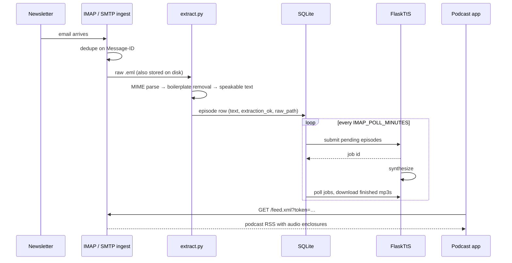

# inbox2pod

Turn the newsletters in your mailbox into a self-hosted podcast feed.

inbox2pod watches email, pulls the actual prose out of the HTML soup, hands it
to [FlaskTtS](https://github.com/DerekParks/FlaskTtS) for synthesis, and serves
the result as a podcast feed you can subscribe to in any podcast app. No
scraping, no third-party service reading your inbox, no monthly fee.

Companion to [HoarderToPod](https://github.com/DerekParks/HoarderToPod), which
does the same thing for links you hoard. This one is for the stuff that already
arrives by email.

## AI Disclosure

Parts of this codebase were written with AI assistance (Claude). I use this
project daily and review all AI-generated code before merging. I strive to keep
the codebase clean, understandable, and something I can fully stand behind.

## Why

Newsletter email is already the article. It does not need a scraper, a paywall
dance, or a "read online" click-through — the text is sitting in a MIME part,
wrapped in about forty nested layout tables. Once it is speech, half of a
subscription is stuff you listen to on a walk instead of skimming at your desk.

The interesting problem is not the TTS, it is the extraction. Newsletter HTML is
hostile: tracking pixels, invisible preheaders, sponsor blocks, button grids
where every third word is a link, unsubscribe footers, mojibake from servers
that lie about their charset. That part gets its own module, its own test
corpus, and its own debug UI, because everything downstream is only as good as
the text it was fed.

## How it works



Both ingest sources produce the same `IncomingEmail`, so extraction, storage and
TTS are identical either way. The database is the queue: a NULL `tts_job_id`
means "waiting to be synthesized", a NULL `mp3` means "not done yet". Restarting
mid-synthesis is safe — boot reconcile re-syncs job state with the TTS service.

## Install

You need [FlaskTtS](https://github.com/DerekParks/FlaskTtS) running somewhere
for the audio. It can be the same host.

```bash
mkdir inbox2pod && cd inbox2pod
wget https://raw.githubusercontent.com/DerekParks/inbox2pod/refs/heads/main/docker-compose.yaml
cp sample.env .env   # then edit .env
docker compose up
```

Uncomment the `flasktts` service in the compose file if you do not already run
one, and point `TTS_ROOT_URL` at it (`http://flasktts:5001` when both run in
the same compose project).

Then:

- UI: `http://localhost:5003/`
- Feed: `http://localhost:5003/feed.xml`
- API docs: `http://localhost:5003/docs`
- Health: `http://localhost:5003/health`

## Picking an ingest mode

| | IMAP polling | SMTP receiving |
|---|---|---|
| Setup | 10 minutes, no domain needed | needs a domain, MX record and an open port 25 |
| Credentials | app password for the mailbox | none — the secret is the address you hand out |
| What it can read | everything already in that mailbox | only mail sent to your pod address |
| Blast radius of a leak | mailbox credentials | the address gets spam, which is rejected at RCPT time |
| Side effects | marks mail read (or moves/deletes it) | none, your mailbox never sees the mail |
| Works with | Gmail, Fastmail, Proton Bridge, Dovecot, … | any sender that can deliver to your MX |
| Spam exposure | none, you poll | port 25 is a firehose |

Start with IMAP. Move to SMTP when you want a dedicated `newsletters@yourdomain`
address, or when you would rather not give any app a mailbox password.

### IMAP (default)

Gmail, in about ten minutes:

1. Turn on 2-step verification, then create an
   [app password](https://myaccount.google.com/apppasswords). That string is
   `IMAP_PASSWORD`; your real password is never used.
2. Prefer a dedicated mailbox (a second Gmail account used only for
   newsletters) over your primary inbox.
3. Optionally keep the noise down with a filter: Settings → Filters → Create a
   new filter → put the senders you care about in `From` → *Apply the label*
   `Newsletters` (and *Skip the Inbox* if you never read them there). Then set
   `IMAP_FOLDER=Newsletters` and inbox2pod only ever looks inside that label.
4. `IMAP_AFTER_ACTION` decides what happens to mail that became an episode:
   `mark_seen` (default, safest), `none`, `delete`, or `move:<folder>` for an
   "Processed" folder.
5. Mail forwarded from another account still works: the allowlist and the UI
   use the `From:` *header*, which forwarding leaves alone.

```dotenv
IMAP_HOST=imap.gmail.com
IMAP_PORT=993
IMAP_USER=newsletters@gmail.com
IMAP_PASSWORD=abcdabcdabcdabcd
IMAP_FOLDER=Newsletters
IMAP_POLL_MINUTES=5
IMAP_AFTER_ACTION=mark_seen
```

### SMTP receiver (opt-in)

Set `SMTP_ENABLED=true` and give the container port 25 (compose maps `25:2525`;
the container itself listens on 2525 so it does not need root).

1. A domain whose MX record points at this host, and port 25 reachable from the
   internet. Residential IPs are usually blocked or dynamic — this generally
   means a small VPS, or a mail relay that will forward to your server.
2. Make up a **random local part**. That address is the authentication: nobody
   who does not have it can put anything in your feed.
   ```bash
   python -c "import secrets; print(secrets.token_urlsafe(6))"
   ```
3. `SMTP_ALLOWED_RCPT=x7kq2m@pod.example.com`, then give that address to the
   newsletters you want. Mail to any other recipient is refused with `550`
   during the SMTP conversation, so it never touches disk.
4. `SENDER_ALLOWLIST` is an optional second gate for both modes; with a secret
   address you usually do not need it.
5. STARTTLS is not implemented. Newsletter senders deliver fine without it, and
   the payload is public prose anyway — but the transport is not encrypted, so
   do not put anything private in this mailbox.

Check it end to end with [swaks](https://github.com/jetmore/swaks):

```bash
swaks --to x7kq2m@pod.example.com \
      --from test@newsletter.example \
      --server pod.example.com \
      --header 'Subject: swaks end to end test' \
      --body 'The quick brown fox reads the term structure of interest rates.'
```

The handler does no heavy lifting inside the SMTP transaction: it checks the
envelope, writes the message to a queue, and returns `250`. Extraction and the
database happen on a worker thread, so a slow extraction cannot stall the
connection.

## The feed

`/feed.xml` is plain RSS with the iTunes podcast extension. Only episodes with
audio are listed, oldest→newest internally, newest first in the feed.

Podcast apps cannot do authentication, so if you set `FEED_TOKEN` the feed, the
UI and every audio file require it. Paste whichever form your app tolerates:

```
https://pod.example.com/feed.xml?token=x7kq2m
https://pod.example.com/x7kq2m/feed.xml      # path prefix, survives apps that strip query params
```

Enclosure URLs carry the token in the same path-prefix form, so a podcast app
that accepted the feed URL will accept the audio URLs. With `FEED_TOKEN` unset
everything is open — fine on a LAN, not fine on the public internet.

The stored `.eml` files are what make re-runs possible: after fixing an
extractor, hit *re-extract* in the UI and the episode is rebuilt from the
original message, re-queued for TTS, and the stale mp3 is deleted.

## Configuration

Everything lives in environment variables (see `sample.env` for the annotated
version).

| Variable | Default | What it does |
|---|---|---|
| `IMAP_HOST` / `IMAP_PORT` | — / `993` | IMAP server; unset disables the poller |
| `IMAP_USER` / `IMAP_PASSWORD` | — | Mailbox credentials (app password for Gmail) |
| `IMAP_FOLDER` | `INBOX` | Mailbox or label to poll |
| `IMAP_POLL_MINUTES` | `5` | Poll interval |
| `IMAP_MAX_EMAILS_PER_POLL` | `25` | Cap per poll; `0` for no limit |
| `IMAP_AFTER_ACTION` | `mark_seen` | `mark_seen` \| `none` \| `delete` \| `move:<folder>` |
| `SMTP_ENABLED` | `false` | Run the SMTP receiver |
| `SMTP_LISTEN_HOST` / `SMTP_LISTEN_PORT` | `0.0.0.0` / `2525` | Where the receiver listens |
| `SMTP_ALLOWED_RCPT` | *(empty = accept all)* | Accepted recipient addresses/local parts |
| `SMTP_MAX_SIZE` | `10485760` | Rejected-over size, in bytes |
| `SENDER_ALLOWLIST` | *(empty = accept all)* | Addresses or domains, both ingest modes |
| `TTS_ROOT_URL` | `http://localhost:5001` | FlaskTtS base URL |
| `TTS_MODEL` / `TTS_VOICE` | `kokoro` / `af_heart` | Passed straight to FlaskTtS |
| `TTS_BATCH_SIZE` | `10` | Episodes submitted per cycle |
| `TTS_WOL_ENABLED` / `TTS_WOL_MAC` | `false` / — | Wake the TTS box with a magic packet |
| `DATABASE_URI` | `sqlite:///data/inbox2pod.db` | Any SQLAlchemy URI |
| `RAW_STORAGE_PATH` / `MP3_STORAGE_PATH` | `data/raw` / `data/audio` | Stored `.eml` and audio |
| `EPISODE_RETENTION_DAYS` | *(keep forever)* | Age off older episodes and their audio |
| `FEED_TITLE` / `FEED_DESCRIPTION` / `FEED_AUTHOR` | `Inbox2Pod` / … | Feed metadata |
| `FEED_OWNER_EMAIL` | *(falls back to `IMAP_USER`)* | `itunes:owner`, needed to submit to directories |
| `FEED_LANGUAGE` | `en-us` | Feed language |
| `FEED_SITE_URL` | *(request host)* | The `<link>` the feed advertises |
| `FEED_TOKEN` | *(empty = no auth)* | Gate for feed, UI and audio |
| `FEED_MAX_EPISODES` | `1000` | Items in the feed |
| `MIN_TEXT_LENGTH` | `200` | Shorter extractions are flagged, not synthesized |
| `DESCRIPTION_LENGTH` | `300` | Feed description length |
| `PORT` | `5003` | HTTP port |

## Extraction, and how to fix it when it is wrong

`extract.py` parses the MIME structure, then:

1. `text/html` runs through **trafilatura → readability → html2text →
   BeautifulSoup**, first result with enough text wins.
2. If `text/plain` is materially longer than what the HTML gave up, plain wins
   (some digests are plain-text-native).
3. The result goes through the speakability pass: mojibake repair, zero-width
   and emoji stripping, markdown flattening, footer cut, boilerplate line drop,
   repeated-line dedupe (newsletter buttons stacked in a table become one line),
   URL markup removal, whitespace collapse.

Episodes whose text lands under `MIN_TEXT_LENGTH` are **flagged in the UI
instead of synthesized** — a 40-second reading of "unsubscribe" is not a podcast
episode. You can still look at them, re-extract, or lower the threshold.

When an episode comes out wrong:

- Open it in the UI to see the extractor that won, the word count, and the text.
- Fix the extraction, then *re-extract* — it rebuilds from the stored `.eml`.
- Reproduce locally, without any mail involved:

```bash
uv run python -m inbox2pod.extract path/to/message.eml
uv run python -m inbox2pod.extract --bakeoff tests/fixtures   # every extractor, every fixture
```

Every real-world failure mode should become a fixture. `tests/fixtures/` holds
synthetic newsletters (`tests/make_fixtures.py`) covering long-form, digests,
image-heavy marketing, plain-text quoted-printable, lying charsets, missing
Message-IDs, tracking-pixel-only mail, quoted replies, attachments, broken
headers and forwarded mail. Drop real `.eml` files in there too — just scrub
anything private from them first.

## Development

[uv](https://docs.astral.sh/uv/) and Python 3.11+.

```bash
uv sync --all-extras
uv run pytest              # the whole suite is offline
uv run ruff check .
FLASK_ENV=dev uv run python run.py
```

Nothing in the test suite touches the network: IMAP runs against a fake mailbox,
the SMTP tests drive the aiosmtpd handler directly plus one real conversation
over a loopback socket, and FlaskTtS is mocked at the HTTP layer. The `.eml`
corpus drives extraction.

To poke at the app without a mailbox, drop a raw message in and run the
pipeline:

```bash
python - <<'PY'
from inbox2pod.ingest.base import parse_email
from inbox2pod.pipeline import process_incoming
print(process_incoming(parse_email(open("sample.eml", "rb").read())))
PY
```

## Not in v1

Deliberately left out, in rough order of how much I want them:

- **Multi-feed routing** — recipient plus-address or sender rules → separate
  feeds. The `feed` column is already in the schema.
- **"Read in browser" follow-up** — some newsletters only send a teaser;
  following the link would fix those. That is scraping, with the maintenance it
  implies.
- **Optional LLM cleanup/summarization** as a plugin; the core must never
  require a model.
- **RSS ingest** (which would subsume "I want to kill my newsletter
  subscriptions" users), IMAP IDLE instead of polling, `itunes:duration` via
  ffprobe.

## Credit

- [HoarderToPod](https://github.com/DerekParks/HoarderToPod) — the sibling this
  was lifted from; the TTS client, boot-reconcile logic and episode queue
  semantics are battle-tested there.
- [FlaskTtS](https://github.com/DerekParks/FlaskTtS) — does the actual voices.
- [imap-tools](https://github.com/ikvk/imap_tools),
  [aiosmtpd](https://aiosmtpd.readthedocs.io/),
  [trafilatura](https://github.com/adbar/trafilatura),
  [readability-lxml](https://github.com/buriy/python-readability),
  [feedgen](https://pypi.org/project/feedgen/) — the boring parts.

## License

MIT — see [LICENSE](LICENSE).
